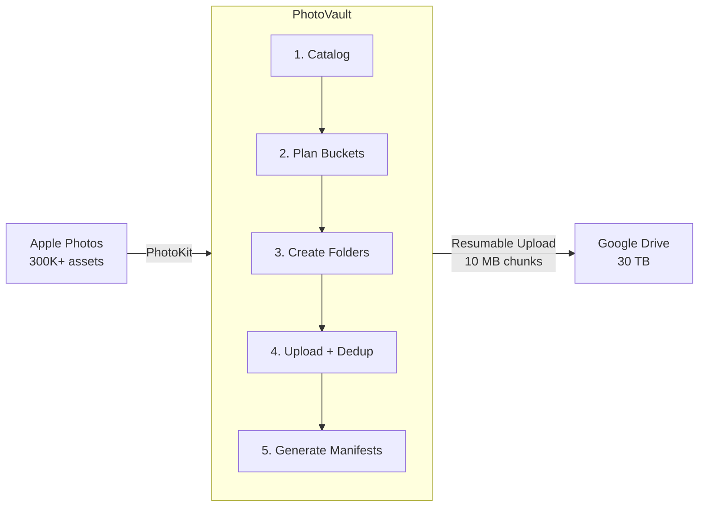
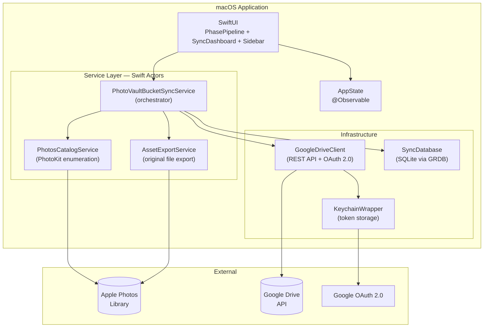
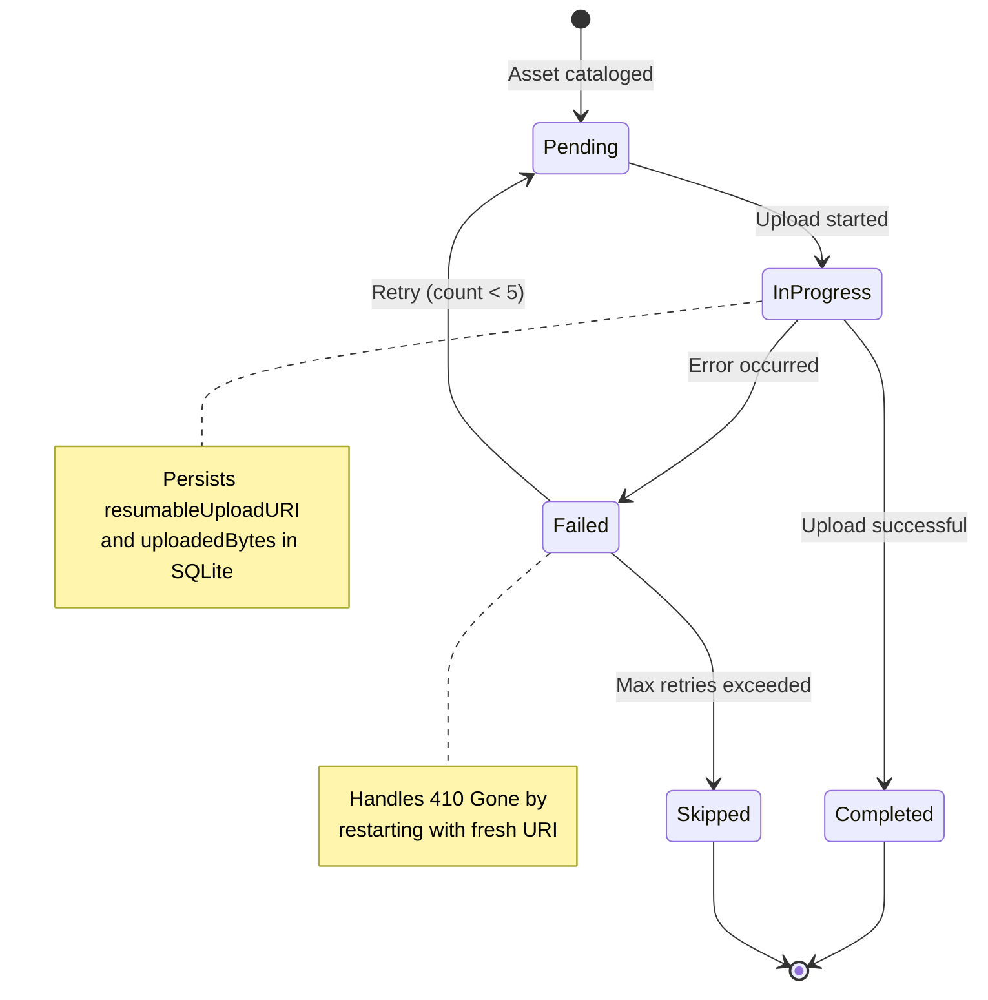
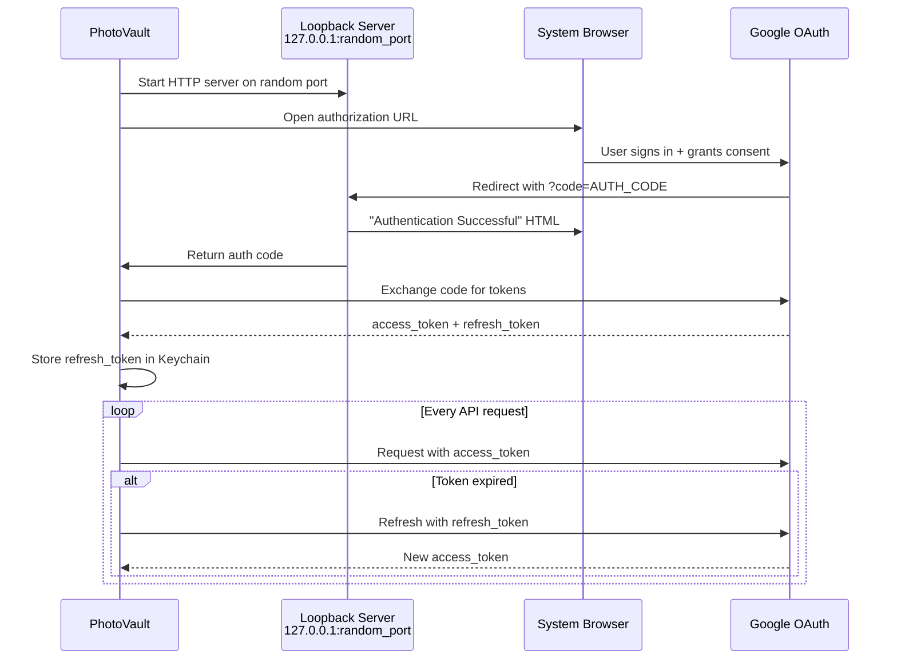

<p align="center">
  
  
  
  
</p>

# PhotoVault

**Back up your entire Apple Photos library to Google Drive — with full album preservation.**

PhotoVault is a native macOS app that creates a complete, deduplicated backup of your Apple Photos library to Google Drive. Every photo and video is uploaded in original quality, organized into browsable year/week folders, with album structure preserved through JSON manifests that allow full reconstruction.

Built for large libraries. Tested with **300,000+ assets** and **11 TB** of media.

---

## Why PhotoVault?

Apple Photos is great for organization. iCloud is great for sync. But if you want an independent, browsable backup of your entire library on Google Drive — there's nothing that does it right:

| Problem | PhotoVault's Solution |
|---------|----------------------|
| Exporting loses album structure | JSON manifests preserve every album, folder, and sort order |
| Same photo in 10 albums = 10 copies | MD5 deduplication — each file stored **once**, referenced many times |
| 11 TB can't upload in one session | Resumable uploads with per-chunk persistence — pick up where you left off |
| Drive becomes a mess of folders | Clean `media/YYYY/WXX/` structure — browse photos by date without any tools |
| No way to reconstruct albums | Manifests + master catalog = full album restoration from backup |

---

## How It Works



### The Five Phases

| Phase | What It Does | Progress Tracking |
|-------|-------------|-------------------|
| **Cataloging** | Enumerates all albums, smart albums, and folder hierarchies via PhotoKit | Albums processed / total |
| **Planning** | Groups assets into year/week buckets using ISO 8601 week numbering | Bucket distribution stats |
| **Creating Folders** | Builds the `media/YYYY/WXX/` folder tree in Google Drive | Folders created / total |
| **Uploading** | Streams original files to Drive with MD5 dedup and resumable chunked uploads | Bytes uploaded, ETA, per-file progress |
| **Manifests** | Generates album JSON files and master `_catalog.json` | Manifests generated / total |

---

## Google Drive Structure

```
Apple Photos Backup/
├── media/
│   ├── 1939/
│   │   └── W01/
│   ├── ...
│   ├── 2024/
│   │   ├── W01/
│   │   │   ├── IMG_0001.HEIC
│   │   │   ├── IMG_0002.HEIC
│   │   │   └── VID_0003.MOV
│   │   ├── W02/
│   │   └── ...W52/
│   ├── 2025/
│   └── undated/
├── albums/
│   ├── Smart Albums/
│   │   ├── Favorites.json
│   │   ├── Screenshots.json
│   │   └── Recents.json
│   ├── Vacations/
│   │   ├── Hawaii 2023.json
│   │   └── Japan 2024.json
│   └── Family/
│       └── Kids.json
└── _catalog.json
```

**Media files** live in date-based buckets. **Album manifests** are lightweight JSON files that reference media by path and Drive file ID. The **master catalog** is a single JSON index of every asset in the backup.

---

## Architecture



### Key Design Decisions

- **Actors everywhere** — `GoogleDriveClient`, `SyncDatabase`, `AssetExportService`, and the sync orchestrator are all Swift actors for safe concurrency
- **Streaming, not loading** — Files are exported to a temp directory and streamed to Drive in 10 MB chunks. A 4K video never touches memory as a whole
- **Deduplication via MD5** — Before uploading, each file's checksum is computed and checked against the database. Same photo in 20 albums = 1 upload
- **Resumable everything** — Upload URIs, byte offsets, and retry counts are persisted in SQLite. Kill the app mid-upload, relaunch, and it continues from the last successful chunk

---

## Upload State Machine



---

## OAuth Flow

PhotoVault uses the **Desktop app** OAuth 2.0 flow with a localhost loopback server — no browser extensions, no custom URL schemes.



**Scopes requested:**
- `drive.file` — Access only files created by PhotoVault (cannot see your other Drive files)
- `userinfo.email` + `userinfo.profile` — Display your account in Settings

---

## Quick Start

### Prerequisites

- macOS 14.0+ (Sonoma)
- Xcode 15.0+
- [XcodeGen](https://github.com/yonaskolb/XcodeGen) — `brew install xcodegen`
- A Google account with sufficient Drive storage
- For large libraries: a Mac with all Photos originals downloaded locally

### 1. Clone and Build

```bash
git clone https://github.com/welshofer/photovault.git
cd photovault
xcodegen generate
open PhotoVault.xcodeproj
```

In Xcode:
- Select your **signing team** (Signing & Capabilities)
- Build and run (`Cmd+B`, `Cmd+R`)

### 2. Set Up Google Cloud

> **Full step-by-step guide with screenshots: [docs/GOOGLE_CLOUD_SETUP.md](docs/GOOGLE_CLOUD_SETUP.md)**

Quick version:

1. Go to [Google Cloud Console](https://console.cloud.google.com/) → Create new project
2. Enable the **Google Drive API**
3. Configure **OAuth consent screen** (External, add yourself as test user)
4. Create **OAuth credentials** → **Desktop app** type
5. Copy the **Client ID** and **Client Secret**

### 3. Configure Credentials

**Option A: Environment variables** (recommended for development)

Create a `.env` file in the project root (gitignored):
```bash
GOOGLE_CLIENT_ID=your-client-id.apps.googleusercontent.com
GOOGLE_CLIENT_SECRET=GOCSPX-your-client-secret
```

Set them in your Xcode scheme: Product → Scheme → Edit Scheme → Run → Arguments → Environment Variables.

**Option B: Edit source** (simpler for personal use)

Update the fallback values in `Sources/PhotoVaultApp.swift`:
```swift
private var clientID: String {
    ProcessInfo.processInfo.environment["GOOGLE_CLIENT_ID"]
        ?? "YOUR_CLIENT_ID.apps.googleusercontent.com"
}
private var clientSecret: String {
    ProcessInfo.processInfo.environment["GOOGLE_CLIENT_SECRET"]
        ?? "GOCSPX-YOUR_CLIENT_SECRET"
}
```

### 4. First Run

1. Launch PhotoVault
2. Click **Sign in with Google** — your browser opens
3. Sign in with the Google account that has Drive storage
4. Grant PhotoVault access (click "Advanced" → "Go to PhotoVault" if you see the unverified app warning)
5. Return to PhotoVault — you'll see the sync dashboard
6. Click **Start Sync**

### 5. Verify in Google Drive

After the sync completes, check your Google Drive:
- `Apple Photos Backup/media/` — your photos organized by year/week
- `Apple Photos Backup/albums/` — JSON manifests for each album
- `Apple Photos Backup/_catalog.json` — master index of everything

---

## Configuration

Edit `Sources/PhotoVaultApp.swift` in the `initializeSyncService` method:

```swift
var config = SyncConfiguration(appSupportDir: appSupport)
config.debugMaxAssets = 0            // 0 = no limit, N = stop after N uploads (for testing)
config.skipICloudOnlyAssets = false   // true = skip assets only in iCloud
config.maxConcurrentUploads = 3      // parallel upload streams
config.maxRetries = 5                // retry failed uploads up to N times
config.rootFolderName = "Apple Photos Backup"  // Drive root folder name
```

| Option | Default | Description |
|--------|---------|-------------|
| `debugMaxAssets` | `0` | Limit uploads for testing (0 = unlimited) |
| `skipICloudOnlyAssets` | `false` | Skip photos not downloaded locally |
| `maxConcurrentUploads` | `3` | Parallel upload streams |
| `uploadChunkSize` | `10 MB` | Resumable upload chunk size |
| `maxRetries` | `5` | Max retries per failed asset |
| `rootFolderName` | `"Apple Photos Backup"` | Top-level Google Drive folder |
| `includeSmartAlbums` | `true` | Include Favorites, Screenshots, etc. |

---

## Album Manifest Format

Each album is stored as a JSON file. Here's what `albums/Vacations/Hawaii 2023.json` looks like:

```json
{
  "albumID": "5F8A3B2C-...",
  "title": "Hawaii 2023",
  "folderPath": ["Vacations"],
  "albumType": "album",
  "lastUpdated": "2026-03-10T15:30:00Z",
  "assetCount": 247,
  "assets": [
    {
      "localID": "A1B2C3D4-...",
      "filename": "IMG_4521.HEIC",
      "drivePath": "media/2023/W48/IMG_4521.HEIC",
      "driveFileID": "1ABC123def456...",
      "creationDate": "2023-12-01T08:30:00Z",
      "mediaType": "image",
      "width": 4032,
      "height": 3024,
      "isFavorite": true,
      "sortOrder": 0
    }
  ]
}
```

To reconstruct an album, parse the manifest and download files by `driveFileID` or `drivePath`.

---

## Reconstructing Albums from Backup

PhotoVault includes `AlbumReconstructor` for restoring albums:

```swift
let reconstructor = AlbumReconstructor(driveClient: client, rootFolderID: rootID)
let manifest = try await reconstructor.loadManifest(fileID: manifestFileID)

// Option 1: Download to a local folder
try await reconstructor.exportAlbumToLocal(
    manifest: manifest,
    destinationPath: downloadsURL
) { completed, total in
    print("Downloaded \(completed)/\(total)")
}

// Option 2: Create a Drive folder with shortcuts to originals
let shortcutFolderID = try await reconstructor.createShortcutAlbum(
    manifest: manifest,
    destinationFolderID: parentFolder
)

// Option 3: Generate a browsable HTML gallery
let html = reconstructor.generateHTMLGallery(manifest: manifest)
```

---

## Error Handling

PhotoVault handles failures gracefully so a multi-day upload doesn't lose progress:

| Error | Handling |
|-------|----------|
| **Network timeout** | Retry with exponential backoff (up to 5 attempts) |
| **HTTP 429 (rate limit)** | Exponential backoff with jitter |
| **HTTP 500/502/503** | Retry with backoff |
| **HTTP 410 (upload URI expired)** | Automatically restart upload with fresh session |
| **OAuth token expired** | Transparent refresh using stored refresh token |
| **iCloud-only asset** | Skip (configurable) or download from iCloud |
| **File export failed** | Mark as failed, continue with next asset |
| **Max retries exceeded** | Mark as skipped, continue sync |

All errors are logged in the sidebar with timestamps. Failed assets can be retried on the next sync run.

---

## Source Files

| File | Lines | Purpose |
|------|-------|---------|
| [`PhotoVaultApp.swift`](Sources/PhotoVaultApp.swift) | ~700 | App entry point, SwiftUI views, OAuth loopback server |
| [`GoogleDriveClient.swift`](Sources/GoogleDriveClient.swift) | ~600 | Google Drive REST API client with resumable uploads |
| [`PhotoVaultBucketSyncService.swift`](Sources/PhotoVaultBucketSyncService.swift) | ~500 | Main sync orchestrator (5-phase pipeline) |
| [`PhotoVaultSyncService.swift`](Sources/PhotoVaultSyncService.swift) | ~550 | Legacy v1 sync service + shared types (SyncProgress, SyncConfiguration) |
| [`SyncDatabase.swift`](Sources/SyncDatabase.swift) | ~400 | SQLite persistence via GRDB |
| [`BucketStorageSchema.swift`](Sources/BucketStorageSchema.swift) | ~350 | Data models, bucket planning, filename resolution |
| [`PhotoKitEnumeration.swift`](Sources/PhotoKitEnumeration.swift) | ~390 | PhotoKit enumeration and asset export |
| [`AlbumReconstructor.swift`](Sources/AlbumReconstructor.swift) | ~250 | Album restoration from manifests |

---

## Performance

| Aspect | Approach |
|--------|----------|
| **Memory** | Files streamed to temp disk, uploaded in 10 MB chunks — never loaded into memory whole |
| **Concurrency** | 3 parallel uploads via Swift `TaskGroup` (configurable) |
| **Rate limiting** | 200ms minimum between API requests (5 req/sec) |
| **Deduplication** | Streaming MD5 in 1 MB chunks — O(1) memory regardless of file size |
| **Resume** | Per-asset state in SQLite: upload URI, byte offset, retry count |
| **Batch processing** | Assets fetched in batches of 100, checkpointed after each |

### Estimated Time for Large Libraries

| Library Size | Estimated Duration* |
|-------------|-------------------|
| 100 GB | ~3 hours |
| 1 TB | ~30 hours |
| 5 TB | ~6 days |
| 11 TB | ~13 days |

*At ~10 MB/s sustained upload. Actual speed depends on your internet connection and Google's rate limits. PhotoVault can be paused and resumed across multiple sessions.*

---

## Security

- **Minimal OAuth scope** — `drive.file` only accesses files PhotoVault creates. It cannot see or modify your other Drive files.
- **Keychain storage** — OAuth tokens stored in macOS Keychain, never in plain text or UserDefaults
- **No telemetry** — Zero analytics, no data sent anywhere except the Google Drive API
- **No deletion capability** — PhotoVault only creates files. It cannot delete anything from your Drive.
- **Credentials not committed** — `.env` and credential files are gitignored

---

## Roadmap

- [ ] **Orphan asset sweep** — Capture photos not in any album (~100K+ assets)
- [ ] **Batch database inserts** — Speed up cataloging for large smart albums
- [ ] **Incremental sync** — Detect and upload only new/changed assets
- [ ] **Unit tests** — Test coverage for bucket planning, dedup, manifest generation
- [ ] **Backup verification** — Checksum audit of existing backup vs local library
- [ ] **Menu bar agent** — Lightweight background status indicator
- [ ] **Scheduling** — Automatic daily/weekly sync
- [ ] **Multiple backends** — S3, Backblaze B2, local NAS

---

## Documentation

| Document | Description |
|----------|-------------|
| [Architecture](docs/ARCHITECTURE.md) | System design with Mermaid diagrams |
| [Google Cloud Setup](docs/GOOGLE_CLOUD_SETUP.md) | Step-by-step Google Cloud project configuration |
| [Code Documentation](docs/CODE_DOCUMENTATION.md) | Detailed source code reference |
| [Product Requirements](docs/PRD.md) | Full PRD with user stories and acceptance criteria |
| [Contributing](CONTRIBUTING.md) | How to contribute |

---

## Built With

- **SwiftUI** — Native macOS interface with `@Observable` state management
- **PhotoKit** — Direct Photos library access without intermediate export
- **GRDB.swift** — SQLite database for upload state persistence
- **Google Drive REST API** — Resumable uploads with chunked transfer
- **CryptoKit** — MD5 checksums for file deduplication
- **XcodeGen** — Project file generation from `project.yml`

---

## License

[MIT](LICENSE) — Use freely. No warranty. See [LICENSE](LICENSE) for details.

---

<p align="center">
  <sub>Built by <a href="https://github.com/welshofer">Jay Welshofer</a> with help from <a href="https://claude.ai/claude-code">Claude Code</a></sub>
</p>
