# PhotoVault Architecture

## System Overview

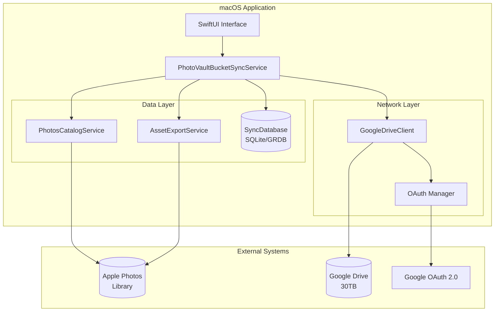

---

## Sync Flow Sequence

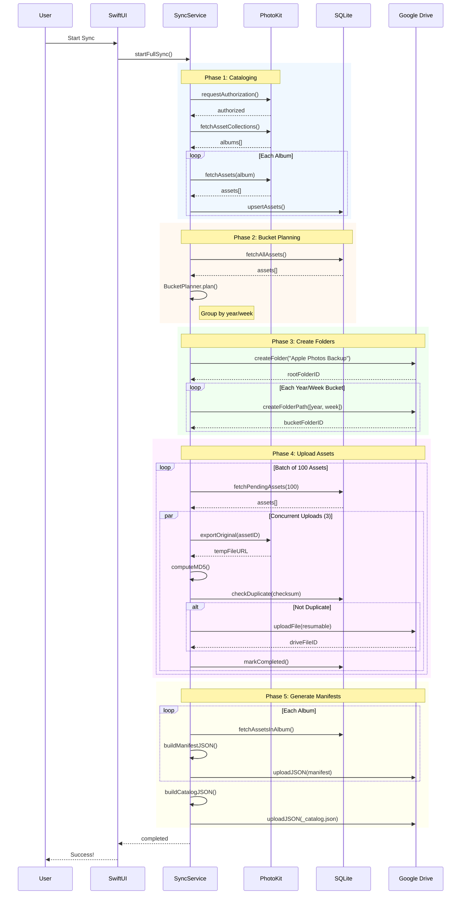

---

## Component Architecture

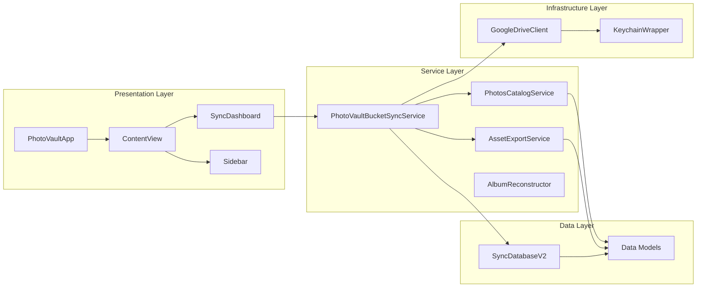

---

## Data Flow

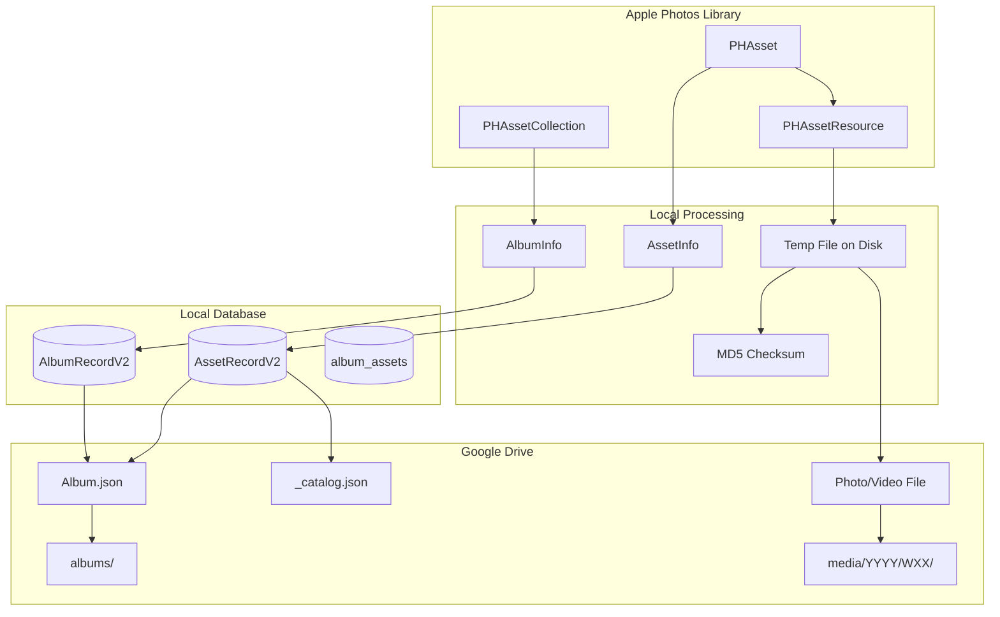

---

## Google Drive Storage Structure

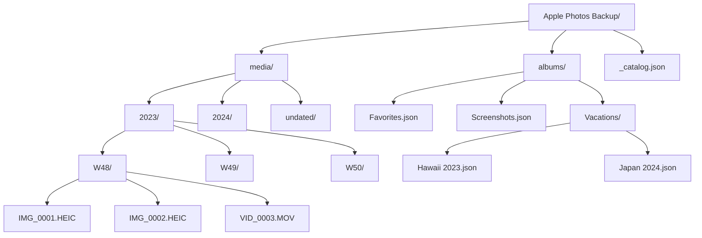

---

## Upload State Machine

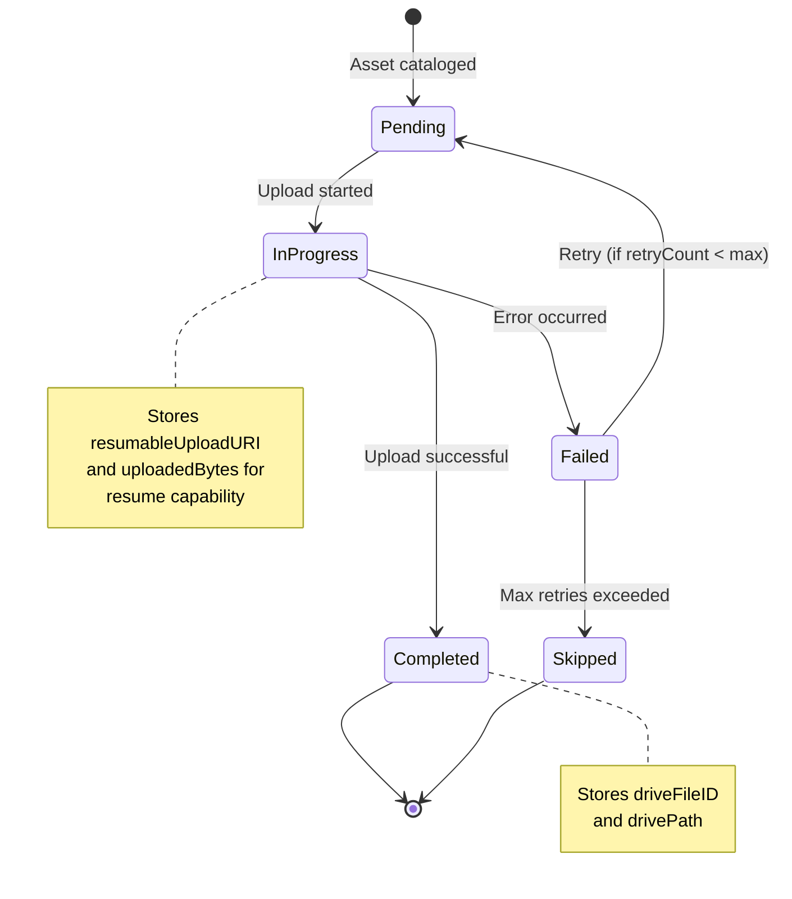

---

## OAuth 2.0 Flow (Desktop App with Loopback Server)

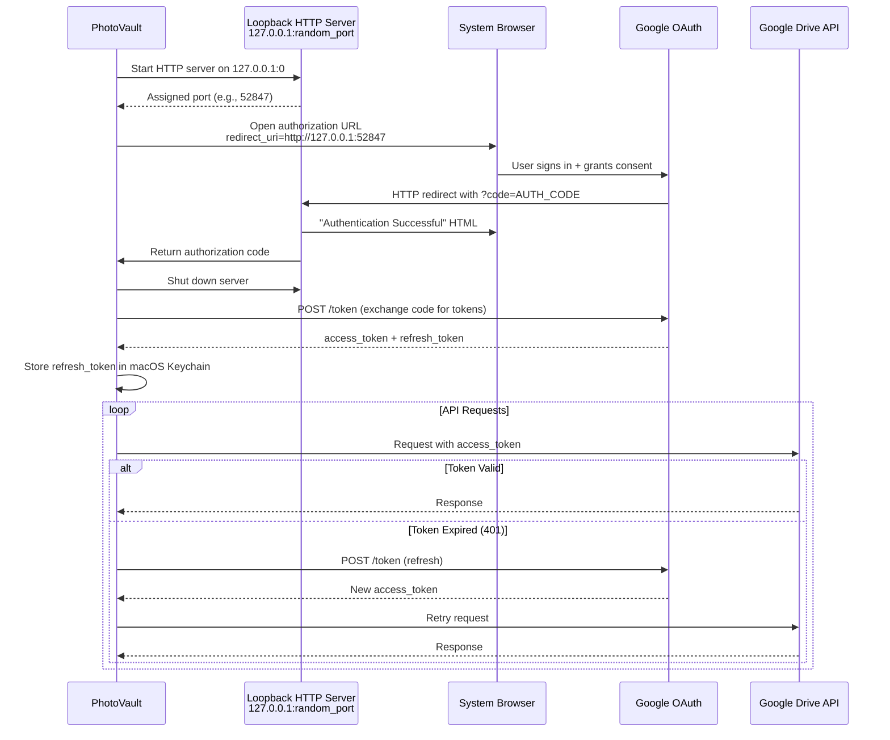

---

## Resumable Upload Protocol

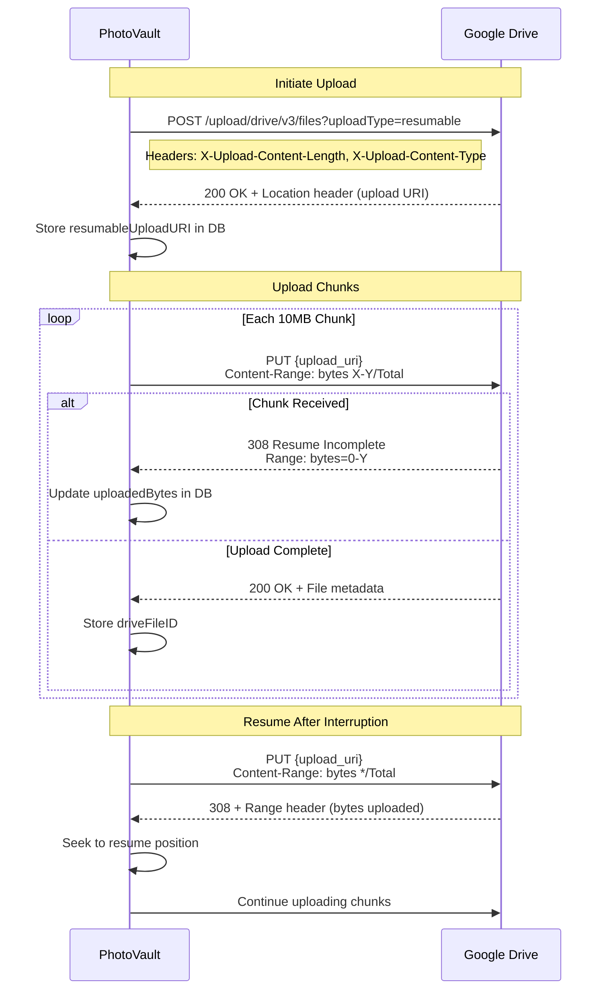

---

## Deduplication Logic

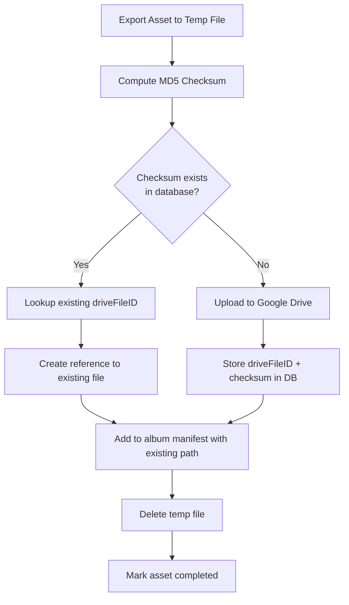

---

## Error Recovery Flow

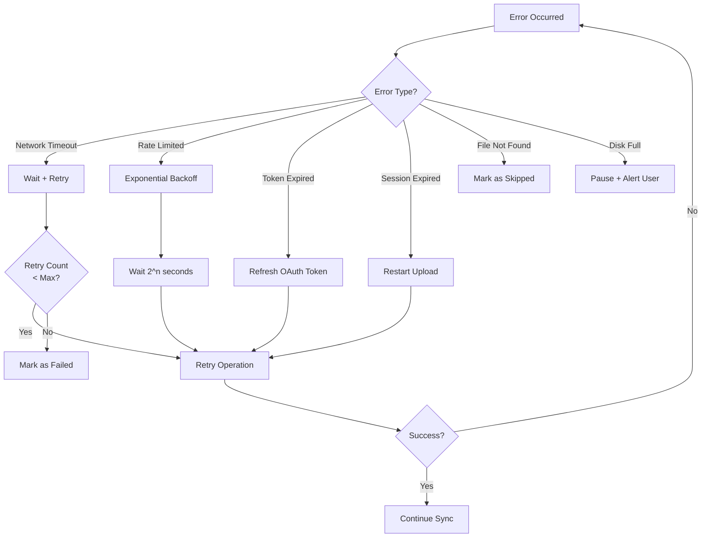

---

## Album Reconstruction Flow

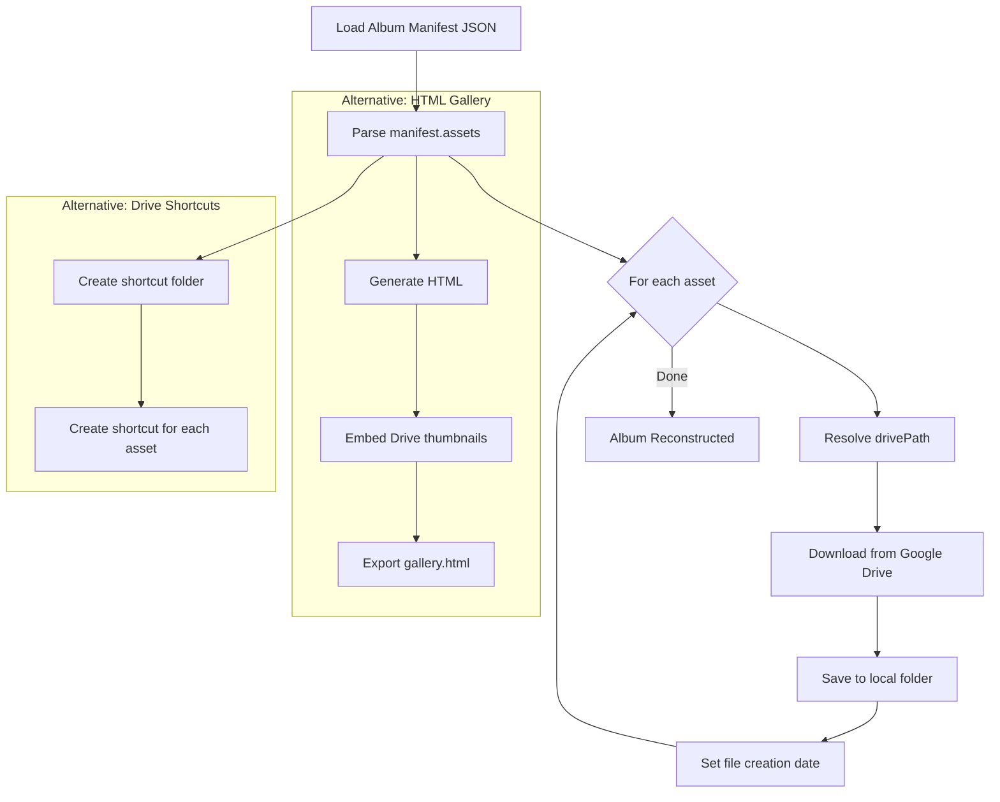

---

## Module Dependencies

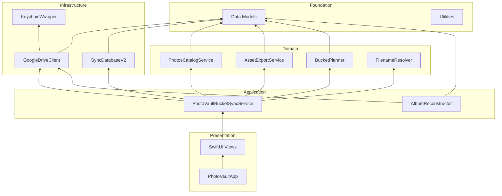
